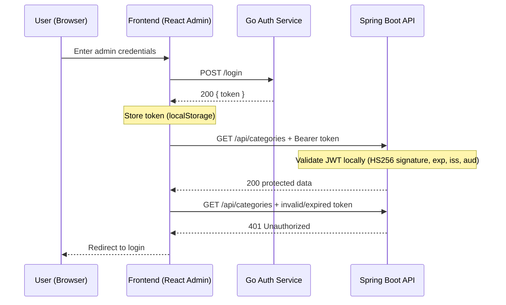

# Go Authentication Service

A lightweight Go authentication service that validates admin credentials and issues JWT tokens.

This service is framework-minimal (`net/http`) and designed to be easy to understand, test, and integrate with multiple backend apps (for example Spring Boot APIs). 

- Backend: https://github.com/alicengalice/expense-wise-backend
- Frontend: https://github.com/alicengalice/expense-wise-frontend

## 🚀 Features
- **Stateless Auth**: Issues HS256 JWT tokens (valid for 24 hours).
- **Lightweight**: Minimal dependency footprint.
- **Security-First**: Constant-time credential check, config validated at startup (fails fast on missing values or a weak secret), environment-based secrets.
- **Observability**: Built-in `/health` check for container orchestration.

> This is a **single-admin** service: there is one login, defined by `ADMIN_USERNAME` / `ADMIN_PASSWORD`. There is no user database.

## 🛠 Requirements
- **Go**: 1.25.0 (refer to `go.mod`)
- **Environment**: a `.env` file in this folder (copy `.env.example`):

| Variable | Required | Description |
|---|---|---|
| `JWT_SECRET` | Yes | Signing secret, at least 32 bytes. Must be identical to the backend's `AUTH_JWT_SECRET`. |
| `ADMIN_USERNAME` | Yes | The admin login name. |
| `ADMIN_PASSWORD` | Yes | The admin password. |
| `JWT_ISSUER` | No | `iss` claim, default `expense-wise-auth`. Must match the backend. |
| `JWT_AUDIENCE` | No | `aud` claim, default `expense-wise-api`. Must match the backend. |
| `PORT` | No | Default `8081`. |

Generate a random secret (never reuse one from documentation):
```bash
openssl rand -base64 48
```
```powershell
# Windows PowerShell
$b = New-Object byte[] 48; [Security.Cryptography.RNGCryptoServiceProvider]::new().GetBytes($b); [Convert]::ToBase64String($b)
```

The service refuses to start if a required variable is missing or the secret is shorter than 32 bytes.

## 💻 Run Locally
```bash
# Download dependencies
go mod download

# Run the service
go run .
```
*Expected output: `Starting auth service on :8081`*

## 🧪 Tests
```bash
go test ./...
```
Covers the login handler, JWT signing/validation (wrong secret, issuer, audience, expired, unsigned tokens) and config loading.

## 🐳 Docker
Multi-stage build (Go toolchain to build, small Alpine image to run):
```bash
docker build -t go-auth-service .
docker run -p 8081:8081 --env-file .env go-auth-service
```

## 🛣 API Endpoints

### 1. Health Check
- **Method**: `GET`
- **URL**: `/health`
- **Response**: `200 OK` | `"Auth service is running"`

### 2. Login
- **Method**: `POST`
- **URL**: `/login`
- **Body**:
```json
{
  "username": "admin",
  "password": "your-password"
}
```

**Responses**

| Status | Body | When |
|---|---|---|
| `200 OK` | `{"token": "<jwt>"}` | Credentials match |
| `401 Unauthorized` | `{"error": "Invalid credentials"}` | Wrong username or password |
| `400 Bad Request` | `Invalid JSON` | Body isn't valid JSON |
| `405 Method Not Allowed` | `Method not allowed. POST method only` | Any method other than `POST` |

### Token contents
HS256-signed JWT, valid for **24 hours**, with these claims:

| Claim | Value |
|---|---|
| `sub`, `username` | The admin username |
| `iss` | `JWT_ISSUER` (default `expense-wise-auth`) |
| `aud` | `JWT_AUDIENCE` (default `expense-wise-api`) |
| `iat` / `exp` | Issued-at / expiry (Unix time) |

### CORS
Browser requests are allowed only from `http://localhost:5173` (the frontend dev server). This is currently hardcoded in `main.go`.

---

## 🔒 Security Architecture: Cross-Service Authentication

This project utilises a **Stateless JWT** architecture. Instead of a monolithic session-store, it follows the **"Sign-at-the-Gate, Verify-at-the-Resource"** pattern.

### Token Trust Flow
1. **Authentication (Go Auth Service)**: Validates credentials and signs a JWT using a shared secret key (HS256).
2. **Persistence (Frontend)**: React-admin stores the token and sends it in the `Authorization` header
3. **Authorisation (Spring Boot Backend)**: Spring validates the JWT locally using the same shared secret: signature, expiry, issuer and audience. No per-request call to Go is required.

### Technical Flow


### Components & Responsibilities

| Component | Responsibility | Key Tech |
| :--- | :--- | :--- |
| **Go Auth** | Credential validation & Token Signing | `net/http`, `golang-jwt`, `godotenv`|
| **Spring Backend** | Stateless Token Validation | `spring-boot-starter-oauth2-resource-server` |
| **Frontend** | Token storage & Header injection | `axios` interceptors, `react-admin` |

---

## 🗺 Roadmap
- [x] **Testing**: Add unit tests for JWT utility and handler logic.
- [ ] **Security+**: Login rate limiting, server timeouts, and a refresh token flow with key rotation.
- [ ] **Configuration**: Make the allowed CORS origin configurable.
- [ ] **Persistence** *(only if multi-user support is needed)*: Store users in PostgreSQL/SQLite.
- [ ] **Authorisation** *(only if multi-user support is needed)*: Add Role-Based Access Control (RBAC) claims to JWT.

## Improvements
:white_check_mark: Added Go auth service Docker containerization with a multi-stage build and .dockerignore optimization for faster, cleaner image builds (4th May 2026)

:white_check_mark: Hardened login and token handling: constant-time credential check, startup config validation, `iss`/`aud`/`iat` claims, and unit tests (21st Nov 2026)
